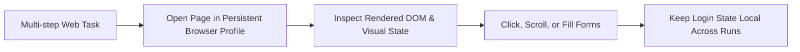

# Browser Automation

Syntiox CORE includes autonomous browser automation so the agent can handle interactive web tasks instead of stopping at static HTTP fetches.

## What It Can Do

- Navigate to target websites and inspect client-rendered pages.
- Research across live web pages and multi-step UI flows.
- Click controls, switch views, and fill out web forms.
- Preserve login sessions locally across runs so authenticated workflows do not need repeated logins on every task.

## Workflow Fit

## Safe Practices

Browser profile state stays on your machine alongside your local Syntiox CORE environment. Never copy or commit local browser data folders, cookies, or tokens into any repository. See [Security & License](../reference/security.md) for local data handling guidelines.
