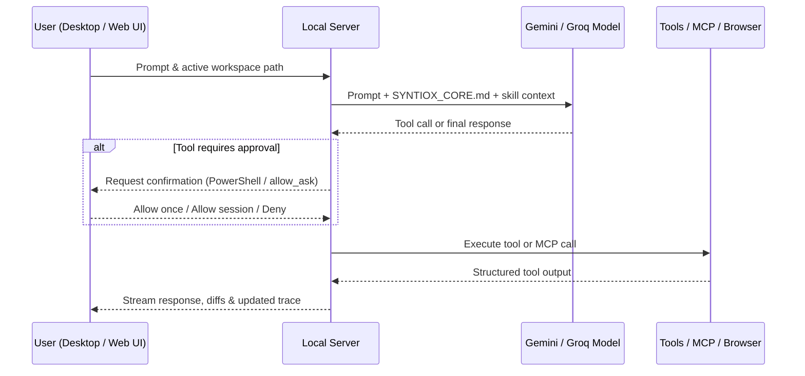

# System Overview

Syntiox CORE is structured as a local-first Windows agent runtime rather than a hosted SaaS proxy. Models run through your own Gemini and Groq API keys while file access, PowerShell execution, browser profiles, and credentials remain on your machine.

## Core Components

- **Native Desktop Shell (Tauri v2):** Lightweight Windows desktop client wrapping the workspace UI with native window lifecycle handling.
- **Compiled Local Server (`syntioxcore-server.exe`):** Runs locally to orchestrate model calls, multi-turn conversation state, tool dispatch, MCP stdio processes, and workspace inspection.
- **Local Web Workspace:** Browser-accessible interface launched from the Start Menu (**Syntiox CORE (Web Workspace)**) with optional PIN protection when accessed over a local network.
- **Persistent Session Memory:** Stores conversation history across sessions so past threads can be listed and resumed at any time.

## Execution Flow



## Data Directory

Runtime configuration, external MCP definitions, custom skills, and global instructions all live under one predictable folder on Windows:

```text
%USERPROFILE%\.sh4lu-z\Syntiox CORE\
```

See [Commands & Paths](../reference/commands-and-paths.md) for the exact layout of files inside this folder.
