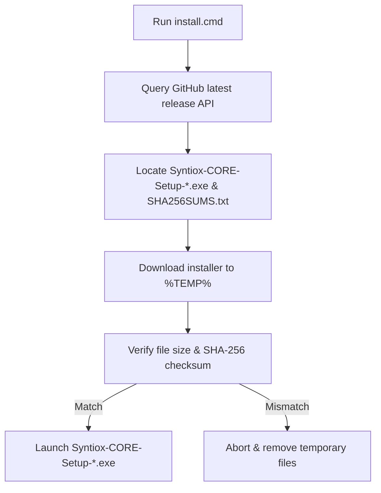

# Installation

Syntiox CORE targets Windows (x64) and ships as a signed/checksum-verified Inno Setup installer (`Syntiox-CORE-Setup-*.exe`).

## Prerequisites

- **Windows (x64)** — Python 3.11 is installed automatically during setup if missing.
- A **Gemini API Key** (and optionally a Google Cloud OAuth 2.0 Desktop client for Google Workspace tools).

## Option 1: Windows Installer (Recommended)

1. Download the latest `Syntiox-CORE-Setup-*.exe` and `SHA256SUMS.txt` from [GitHub Releases](https://github.com/syntiox/syntioxcore/releases/latest).
2. Run the installer and follow the setup prompts.
3. Launch **Syntiox CORE** from the Start Menu or Desktop shortcut, or open **Syntiox CORE (Web Workspace)** from the Start Menu to use it in your browser.

## Option 2: PowerShell Install

Run this command in PowerShell to download `install.cmd`, check the release SHA-256 hash against `SHA256SUMS.txt`, and start the installer automatically:

```powershell
irm https://syntiox.github.io/syntioxcore/install.cmd -OutFile install.cmd ; .\install.cmd
```

> [!NOTE]
> `install.cmd` is designed to be saved and run directly. Do not pipe it into `cmd.exe`.

### How `install.cmd` Verifies the Download



## Next Steps

- Add your API keys in [Configuration (.env)](./configuration.md).
- Connect Gmail, Drive, Docs, and Calendar in [Google Workspace](./google-workspace.md).
