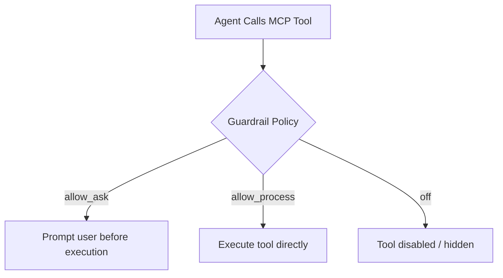

# MCP Servers & Guardrails

Syntiox CORE supports external Model Context Protocol (MCP) servers alongside its built-in integrations.

## Built-in Integrations

These MCP servers are included out of the box:

- **Google Workspace:** `google_calendar`, `google_docs`, `google_drive`, `google_forms`, `google_gmail`, `google_sheets`, `google_slides`, `google_tasks`
- **Utilities & Sandboxes:** `math_solver`, `python_sandbox`, `nodejs_sandbox`, `mouse_keyboard`

## Option 1: Add via App UI

1. Open **Settings > MCP Servers** in Syntiox CORE.
2. Add a server with:
   - **Name:** Short identifier (letters, numbers, `_`, or `-`)
   - **Command:** Executable to run (such as `npx`, `uvx`, `python`, or `node`)
   - **Arguments:** Command arguments (one per line/item)
   - **Environment Variables (optional):** API keys or tokens needed by the server
3. Save the server. Syntiox CORE syncs and loads its tools automatically.

## Option 2: Add via `mcp_servers.json`

Edit the MCP server configuration file at:

```text
%USERPROFILE%\.sh4lu-z\Syntiox CORE\config\mcp_servers.json
```

### Example Configuration

```json
{
  "mcpServers": {
    "sqlite": {
      "command": "uvx",
      "args": ["mcp-server-sqlite", "--db-path", "C:\\data\\test.db"]
    },
    "github": {
      "command": "npx",
      "args": ["-y", "@modelcontextprotocol/server-github"],
      "env": {
        "GITHUB_PERSONAL_ACCESS_TOKEN": "ghp_xxxxxxxxxxxx"
      }
    },
    "custom_python": {
      "command": "python",
      "args": ["C:\\Users\\YourName\\.sh4lu-z\\Syntiox CORE\\mcp\\my_server\\server.py"]
    }
  }
}
```

### Storing Local MCP Server Files

If you write or download a custom MCP server locally, store its files inside:

```text
%USERPROFILE%\.sh4lu-z\Syntiox CORE\mcp\<server_name>\
```

After editing `mcp_servers.json`, click **Sync** in **Settings > MCP Servers** (or restart Syntiox CORE) to load changes.

## Tool Guardrail Modes

Every server and tool can use one of three guardrail policies:



| Mode | Behavior | Recommended For |
| --- | --- | --- |
| `allow_ask` | Prompts for confirmation before running | Destructive actions, outbound emails, external writes |
| `allow_process` | Executes automatically without prompt | Safe read-only lookups and local sandboxes |
| `off` | Disables the server or specific tool | Unused integrations or temporary restrictions |

For Google OAuth setup used by built-in Workspace servers, see [Google Workspace](../getting-started/google-workspace.md).
