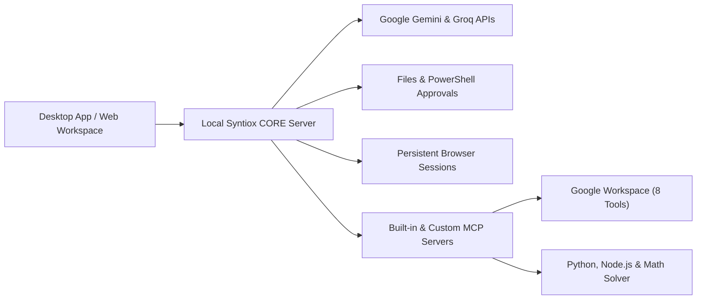

# Syntiox CORE

**A local AI Agent OS for Windows, powered by Google Gemini and Groq.**

Syntiox CORE runs locally on Windows and helps automate multi-step tasks across files, terminals, web browsers, and Google Workspace from a native Desktop App and local Web Workspace.

## What It Includes

| Capability | Description | Guide |
| --- | --- | --- |
| Desktop & Web UI | Native Windows desktop app paired with a local web interface | [Desktop & Web UI](./architecture/workspace-ui.md) |
| Browser Automation | Researches pages, clicks elements, fills forms, and keeps login sessions | [Browser Automation](./architecture/browser-automation.md) |
| Google Workspace | Connects Gmail, Drive, Docs, Sheets, Slides, Forms, Calendar, and Tasks | [Google Workspace](./getting-started/google-workspace.md) |
| MCP & Guardrails | Built-in sandboxes plus external MCP servers with tool permissions | [MCP Servers & Guardrails](./guides/mcp-servers.md) |
| Skills & Rules | Reusable `SKILL.md` workflows and global `SYNTIOX_CORE.md` rules | [Skills & Global Rules](./guides/skills-and-rules.md) |
| API Key Rotation | Automatic rotation across multiple Gemini or Groq keys with session memory | [Configuration (.env)](./getting-started/configuration.md) |

## Architecture Overview

## Quick Links

1. **Install on Windows (x64):** Follow [Installation](./getting-started/installation.md) to run `Syntiox-CORE-Setup-*.exe` or use the PowerShell `install.cmd` helper.
2. **Add your API keys:** Configure `%USERPROFILE%\.sh4lu-z\Syntiox CORE\config\.env` as described in [Configuration (.env)](./getting-started/configuration.md).
3. **Extend with tools:** Add external stdio servers in [MCP Servers & Guardrails](./guides/mcp-servers.md) or write markdown instructions in [Skills & Global Rules](./guides/skills-and-rules.md).
4. **Explore sandboxes & math formatting:** See [Sandboxes & Math](./guides/sandboxes-and-math.md) for code execution sandboxes and live KaTeX rendering.
